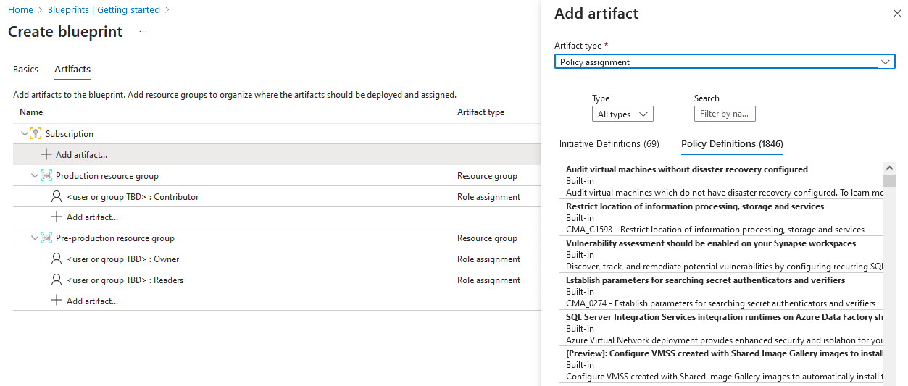
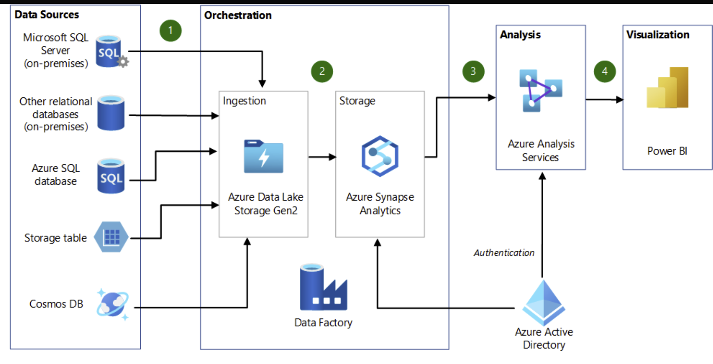
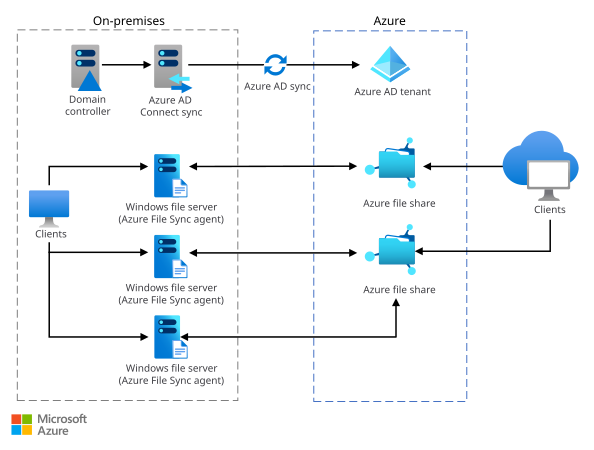

[Azure](azure.md)

# 📚 Resumen comparativo de servicios Azure

## 📑 Índice


- [Tabla comparativa rápida](#-tabla-comparativa-rápida)
- [Azure Analysis Services](#azure-analysis-services)
- [Azure Application Insights](#azure-application-insights)
- [Azure Arc](#azure-arc)
- [Azure Automation](#azure-automation)
- [Azure Backup](#azure-backup)
- [Azure Blueprints](#azure-blueprints)
- [Azure Data Box](#azure-data-box)
- [Azure Data Box Edge](#azure-data-box-edge)
- [Azure Data Box Gateway](#azure-data-box-gateway)
- [Azure Data Factory](#azure-data-factory)
- [Azure Data Lake Storage](#azure-data-lake-storage)
- [Azure Database Migration Service](#azure-database-migration-service)
- [Azure Databricks](#azure-databricks)
- [Azure DevOps](#azure-devops)
- [Azure Event Hubs](#azure-event-hubs)
- [Azure File Sync](#azure-file-sync)
- [Azure Functions](#azure-functions)
- [Azure Import/Export service](#azure-importexport-service)
- [Azure Logic Apps](#azure-logic-apps)
- [Azure Logs Analytics](#azure-logs-analytics)
- [Azure Logs Analytics Workspace](#azure-logs-analytics-workspace)
- [Azure Migrate](#azure-migrate)
- [Azure Monitor](#azure-monitor)
- [Azure Monitor Activity Log](#azure-monitor-activity-log)
- [Azure Notification Hubs](#azure-notification-hubs)
- [Azure Resource Manager](#azure-resource-manager)
- [Azure Service Bus](#azure-service-bus)
- [Azure Stack Hub](#azure-stack-hub)
- [Azure Storage Explorer](#azure-storage-explorer)
- [Azure Storage Sync](#azure-storage-sync)
- [Azure Stream Analytics](#azure-stream-analytics)
- [Azure Synapse Analytics](#azure-synapse-analytics)
- [AzCopy](#azcopy)
- [Role-based access control (RBAC)](#role-based-access-control-rbac)

---

# 📊 Tabla comparativa rápida

| Servicio | Resumen en pocas palabras | Propósito principal | Orientado a |
|----------|--------------------------|--------------------|-------------|
| Azure Analysis Services | Motor tabular BI | Modelos analíticos | BI |
| Azure Arc | Gestión híbrida | Gobierno centralizado | Infra |
| Azure Automation | Runbooks cloud | Automatización | DevOps |
| Azure Backup | Backup gestionado | Protección datos | DR |
| Azure Blueprints | Plantillas governance | Estándares | Governance |
| Azure Data Box | Migración física | Transferencia offline | Migración |
| Azure Data Box Edge | Edge + transferencia | Procesamiento local | Edge |
| Azure Data Box Gateway | Gateway virtual híbrido | Cache + subida | Híbrido |
| Azure Data Factory | ETL/ELT cloud | Integración datos | Data |
| Azure Data Lake Storage | Data lake escalable | Big Data | Analytics |
| Azure Database Migration Service | Migración bases datos | Migración DB | Migración |
| Azure DevOps | CI/CD | Dev lifecycle | DevOps |
| Azure Event Hubs | Streaming masivo | Ingesta eventos | Big Data |
| Azure File Sync | Sincroniza file servers | Extensión Azure Files | Híbrido |
| Azure Functions | Compute serverless | Ejecución por eventos | Serverless |
| Azure Import/Export service | Discos físicos | Migración offline | Migración |
| Azure Logic Apps | Workflows low-code | Integración procesos | Integración |
| Azure Logs Analytics | Consulta logs (KQL) | Análisis logs | Monitor |
| Azure Logs Analytics Workspace | Contenedor logs | Centralización | Monitor |
| Azure Migrate | Evaluación + migración | Migración infra | Migración |
| Azure Monitor | Métricas + logs + alertas | Observabilidad | Operaciones |
| Azure Monitor Activity Log | Log de cambios Azure | Auditoría | Seguridad |
| Azure Notification Hubs | Push móvil | Notificaciones masivas | Usuarios |
| Azure Resource Manager | Motor despliegue | IaC | Infra |
| Azure Service Bus | Mensajería enterprise | Comunicación apps | Backend |
| Azure Stack Hub | Azure on-prem | Extensión híbrida | Infra |
| Azure Storage Explorer | Cliente GUI storage | Gestión blobs | Storage |
| Azure Storage Sync | Sincroniza storage | Extensión Azure Files | Híbrido |
| Azure Stream Analytics | Procesamiento stream en tiempo real | Transformación eventos | Big Data |
| Azure Synapse Analytics | Plataforma analítica unificada | Data warehouse + Big Data | Analytics |
| AzCopy | CLI transferencia | Copia masiva | Storage |
| RBAC | Control acceso granular | Seguridad | Seguridad |

---
### 🔝 [Volver al índice](#-índice)
## Azure Analysis Services

PaaS para modelos tabulares empresariales (semantic layer).  
En AZ-305 debes asociarlo con soluciones BI centralizadas y rendimiento en consultas analíticas.

---
### 🔝 [Volver al índice](#-índice)
## Azure Application Insights 

Azure Application Insights es un servicio de **monitorización APM (Application Performance Monitoring)** que recopila telemetría de aplicaciones en tiempo real.

### 🔎 Tipos de datos / logs que recopila

#### 1️⃣ Requests
- Peticiones HTTP entrantes
- Tiempo de respuesta
- Código de estado (200, 500, etc.)
- Tasa de éxito / fallo

👉 Permite detectar lentitud o errores en endpoints.

#### 2️⃣ Dependencies
- Llamadas salientes a:
  - SQL
  - APIs externas
  - Storage
  - Service Bus
- Duración y éxito/fallo

👉 Útil para identificar cuellos de botella externos.

#### 3️⃣ Exceptions
- Errores y excepciones no controladas
- Stack trace
- Severidad

👉 Clave para troubleshooting.

#### 4️⃣ Traces
- Logs personalizados generados por la aplicación
- Mensajes informativos o de diagnóstico

👉 Equivalente a logs tipo `log.info()`.

#### 5️⃣ Metrics
- CPU
- Memoria
- Tiempo de respuesta
- Throughput
- Contadores personalizados

👉 Para análisis de rendimiento.

#### 6️⃣ Availability Tests
- Pruebas sintéticas (ping/web test)
- Verifica disponibilidad desde distintas regiones

👉 Monitorización externa.

### 🎯 Resumen rápido

Application Insights recopila:
- Requests
- Dependencies
- Exceptions
- Traces
- Metrics
- Availability tests

👉 Se usa para analizar rendimiento y detectar fallos **sin modificar la infraestructura**.


---

### 🔝 [Volver al índice](#-índice)
## Azure Arc

Extiende gestión Azure a on-prem y multi-cloud sin mover recursos.  
Clave para gobierno, Azure Policy y administración híbrida.

---

### 🔝 [Volver al índice](#-índice)
## Azure Automation

Automatiza tareas mediante runbooks (PowerShell/Python).  
Usado para mantenimiento, apagado de VMs y automatización operativa.

---

### 🔝 [Volver al índice](#-índice)
## Azure Backup

Servicio gestionado de backup con retención configurable.  
En arquitectura se usa para protección de VMs, SQL y cargas críticas.

---

### 🔝 [Volver al índice](#-índice)
## Azure Blueprints

Define entornos estandarizados combinando ARM, RBAC y Policy.  
Importante en escenarios enterprise con compliance y landing zones.

**¿Para qué sirven realmente los Azure Blueprints?**

``Estandarizar y automatizar la creación de suscripciones seguras y gobernadas.``

Piensa en esto:

- Cuando creas una nueva suscripción en una empresa, normalmente necesitas:
  - Políticas obligatorias
  - RBAC preconfigurado
  - Resource Groups creados
  - Networking base
  - Tags obligatorios
- En vez de hacerlo manualmente cada vez…
  - 👉 Usas un Blueprint.

**Analogía simple**

 `` Blueprint = plantilla corporativa de suscripción``

**Qué puede incluir un Blueprint**

- Azure Policy
- Role Assignments
- ARM templates
- Resource Groups

**🎯 Ejemplo real**

Empresa crea un Blueprint llamado:

``Corp-Standard-Subscription``

- Incluye:
  - Policy: Solo regiones EU
  - Policy: Tags obligatorios
  - RBAC: Security Team como Reader
  - Resource Group: Networking
  - VNet base
-Cada vez que crean una nueva suscripción:
  - → La asignan al Blueprint
  - → Todo se despliega automáticamente

**Azure Blueprints tiene dos partes principales:**

  1. **Blueprint Definition**  Define qué se va a desplegar y gobernar.
  2. **Blueprint Assignment**  Es cuando aplicas la definición (Sólo  a nivel de Subscription)
   
**Donde se pueden aplicar**

| Componente           | Se crea en                      | Se aplica en |
| -------------------- | ------------------------------- | ------------ |
| Blueprint Definition | Management Group o Subscription | —            |
| Blueprint Assignment | —                               | Subscription |

**🧠 Regla mental examen**

- Definition → nivel organizativo (MG recomendado)
- Assignment → nivel operativo (Subscription)



---

### 🔝 [Volver al índice](#-índice)
## Azure Data Box

Dispositivo físico para mover grandes volúmenes de datos offline.  
Se elige cuando el ancho de banda es limitado.

---

### 🔝 [Volver al índice](#-índice)
## Azure Data Box Edge

Dispositivo físico con capacidad de procesamiento local (GPU opcional).  
Ideal para edge computing y preprocesado antes de enviar a Azure.

---

### 🔝 [Volver al índice](#-índice)
## Azure Data Box Gateway

Gateway virtual con caché local que sube datos a Azure Storage.  
Se usa en escenarios híbridos y DR con transferencia continua.

---

### 🔝 [Volver al índice](#-índice)
## Azure Data Factory

Servicio ETL/ELT para integrar y transformar datos.  
En arquitectura se usa para pipelines de datos y migraciones complejas.

| Componente                   | Qué es                           | Para qué sirve                       | Ejemplo típico examen                         |
| ---------------------------- | -------------------------------- | ------------------------------------ | --------------------------------------------- |
| **Pipeline**                 | Contenedor lógico de actividades | Orquestar procesos ETL/ELT           | Ejecutar copia + transformación + SP en orden |
| **Activity**                 | Tarea dentro del pipeline        | Ejecutar una acción concreta         | Copy, Stored Procedure, Databricks            |
| **Copy Activity**            | Actividad de movimiento de datos | Import / Export datos entre sistemas | SQL → Blob Storage                            |
| **Dataset**                  | Definición del dato              | Describe estructura y ubicación      | Tabla SQL, CSV en Data Lake                   |
| **Linked Service**           | Definición de conexión           | Configura acceso a origen/destino    | Conexión a Oracle on-prem                     |
| **Integration Runtime (IR)** | Motor de ejecución               | Ejecuta actividades                  | Self-hosted IR para on-prem                   |
| **Data Flow**                | Transformación visual            | Transformar datos sin código         | Join + Aggregate + Filter                     |
| **Trigger**                  | Disparador automático            | Ejecutar pipelines automáticamente   | Schedule diario 02:00                         |
| **Monitoring**               | Panel de seguimiento             | Ver ejecuciones y errores            | Ver fallo en actividad Copy                   |



---

### 🔝 [Volver al índice](#-índice)
## Azure Data Lake Storage

Almacenamiento optimizado para Big Data y analítica masiva.  
Clave en soluciones de analytics con Synapse, Databricks o Spark.

---

### 🔝 [Volver al índice](#-índice)
## Azure Database Migration Service

Migra bases de datos online u offline con mínimo downtime.  
Se elige cuando se necesita transición controlada a PaaS o Azure VM.

---

### 🔝 [Volver al índice](#-índice)
## Azure DevOps

Plataforma CI/CD con repositorios, pipelines y boards.  
En AZ-305 aparece en escenarios de automatización y despliegue.

---

### 🔝 [Volver al índice](#-índice)
## Azure Event Hubs

Servicio de streaming masivo para ingestión en tiempo real.  
Se diferencia de Service Bus por volumen y orientación a Big Data.

---

### 🔝 [Volver al índice](#-índice)
## Azure File Sync

Sincroniza file servers locales con Azure Files.  
Permite cloud tiering y extensión híbrida del almacenamiento.



---

### 🔝 [Volver al índice](#-índice)
## Azure Functions

Compute serverless orientado a eventos.  
Modelos: Consumption (pago por uso), Premium (sin cold start), Dedicated (App Service).

---

### 🔝 [Volver al índice](#-índice)
## Azure Import/Export service

Permite enviar discos físicos a Azure para migraciones offline.  
Alternativa cuando Data Box no está disponible.

---

### 🔝 [Volver al índice](#-índice)
## Azure Logs Analytics

Servicio para consultar logs con KQL.  
Parte fundamental de Azure Monitor para troubleshooting.

Es: Motor de análisis de logs centralizado.

- Puede almacenar:
  - Logs de VMs
  - Logs de Azure AD
  - Logs de Network
  - Logs de Security
  - Logs personalizados
- Permite:
  - Consultas con KQL
  - Dashboards
  - Alertas avanzadas
  - Sentinel

**Azure Activity Log vs Azure Log Analytics**
| Característica        | **Azure Activity Log**                              | **Azure Log Analytics**                            |
| --------------------- | --------------------------------------------------- | -------------------------------------------------- |
| ¿Qué es?              | Registro de operaciones a nivel de suscripción      | Plataforma de análisis de logs basada en KQL       |
| Nivel                 | Control plane (ARM)                                 | Control + Data plane                               |
| Qué registra          | Operaciones sobre recursos (create, delete, update) | Logs de recursos, métricas, eventos, Security logs |
| Alcance               | Por Subscription                                    | Workspace centralizado                             |
| Retención por defecto | 90 días                                             | Configurable (según plan)                          |
| Consultas avanzadas   | ❌ No (vista básica)                                 | ✅ Sí (Kusto Query Language - KQL)                  |
| Exportación           | Sí (Storage, Event Hub, Log Analytics)              | Nativo (ya está en workspace)                      |
| Soporta alertas       | Sí (básicas)                                        | Sí (avanzadas, basadas en KQL)                     |
| Uso típico            | Auditoría administrativa                            | Monitorización, seguridad, troubleshooting         |
| Ejemplo               | “Quién borró una VM”                                | “Qué procesos consumen más CPU en las VMs”         |


---

### 🔝 [Volver al índice](#-índice)
## Azure Logs Analytics Workspace

Contenedor lógico donde se almacenan logs.  
Diseño arquitectónico clave para centralización y retención.

---

### 🔝 [Volver al índice](#-índice)
## Azure Migrate

Evalúa y migra VMs, apps y bases de datos.  
Primera herramienta que se usa en proyectos de migración.

designed to assess on-premises infrastructure and provide insights into the TCO of the migration, 
as well as recommendations for the appropriate size of Virtual Machines required for Azure.

---

### 🔝 [Volver al índice](#-índice)
## Azure Monitor

Servicio central de monitorización en Azure.

- Recolecta:
  - Métricas
  - Logs
  - Diagnósticos
  - Activity Logs
  - Telemetría de aplicaciones
- 📌 Qué monitoriza
  - Máquinas virtuales
  - Redes
  - Bases de datos
  - Storage
  - Apps
  - Recursos Azure en general
    
En Azure Monitor las alertas se construyen con dos componentes principales:

- **Alert Rule** → Detecta una condición
  - "Si ocurre X condición → dispara una alerta"
- **Action Group** → Define qué hacer cuando se cumple

###  Componentes de una Alert Rule

| Componente | Función |
|------------|----------|
| Scope | Qué recurso(s) se monitorizan |
| Condition | Qué métrica o evento dispara la alerta |
| Action Group | Qué acciones ejecutar |


### 🔎 Tipos de Alert Rules

#### 1️⃣ Metric Alert
- Basadas en métricas numéricas
- Evaluación casi en tiempo real
- No requiere Log Analytics

Ejemplo:
CPU > 80% durante 5 minutos

---

#### 2️⃣ Log Alert
- Basadas en consultas KQL
- Requieren Log Analytics Workspace
- Muy flexibles

Ejemplo:
````kql
AzureActivity
| where ActivityStatus == "Failed"
````


````
Azure Monitor
   ├── Log Analytics (Logs centralizados)
   └── Application Insights (telemetría de aplicaciones)
````

- 👉 Azure Monitor es el paraguas.
  - Los otros dos son componentes dentro de él.

---

### 🔝 [Volver al índice](#-índice)
## Azure Monitor Activity Log

Registra cambios en recursos Azure.  
Se usa para auditoría y compliance.

- Ejemplo:
  - Crear VM
  - Modificar NSG
  - Eliminar Storage Account
- No registra:
  - Logs internos de la VM
  - Eventos del sistema operativo
    
---

### 🔝 [Volver al índice](#-índice)
## Azure Notification Hubs

Servicio para enviar push notifications masivas a móviles.  
No es mensajería backend, sino comunicación con usuarios finales.

---

### 🔝 [Volver al índice](#-índice)
## Azure Resource Manager

Motor de despliegue de recursos mediante ARM templates.  
Base de Infraestructura como Código en Azure.

---

### 🔝 [Volver al índice](#-índice)
## Azure Service Bus

Mensajería enterprise (queues y topics).  
Se usa para desacoplar microservicios con entrega confiable.

---

### 🔝 [Volver al índice](#-índice)
## Azure Stack Hub

Permite ejecutar servicios Azure en tu datacenter.  
Clave en escenarios híbridos con requisitos regulatorios.

---

### 🔝 [Volver al índice](#-índice)
## Azure Storage Explorer

Cliente gráfico para gestionar blobs, files y tables.  
Herramienta operativa, no arquitectónica.

---

### 🔝 [Volver al índice](#-índice)
## Azure Storage Sync

Sincroniza almacenamiento local con Azure Files.  
Se usa para extender almacenamiento on-prem a la nube.

---

### 🔝 [Volver al índice](#-índice)
## AzCopy

CLI para copiar grandes volúmenes de datos a Azure Storage.  
Muy usado en migraciones y cargas masivas.

---

### 🔝 [Volver al índice](#-índice)
## Role-based access control (RBAC)

Modelo de autorización basado en Security Principal + Role + Scope.  
Clave en diseño de seguridad y gobierno en AZ-305.

---

### 🔝 [Volver al índice](#-índice)
## Azure Logic Apps

Servicio de integración y automatización basado en workflows low-code.  
Se usa para integrar sistemas (SaaS, on-prem, APIs) sin escribir código complejo.

---

### 🔝 [Volver al índice](#-índice)
## Azure Stream Analytics

Motor de procesamiento de eventos en tiempo real mediante consultas SQL-like.  
Se usa junto a Event Hubs o IoT Hub para transformar y enrutar datos en streaming.

---

### 🔝 [Volver al índice](#-índice)
## Azure Synapse Analytics

Plataforma analítica unificada que combina Data Warehouse, Spark y Data Lake.  
Clave en arquitecturas de Big Data y análisis empresarial a gran escala.

Azure Synapse Analytics service, formerly known as Azure SQL Data Warehouse, is a cloud-based analytics service that combines big data and data warehousing capabilities. It allows you to analyze large volumes of data and provides integration with Azure Data Lake Storage and Azure Data Factory. Given the need for a data warehouse and big data analytics system in the desired target state, Azure Synapse Analytics service is the most appropriate choice.

---
### 🔝 [Volver al índice](#-índice)
## Azure Databricks

Azure Databricks is an Apache Spark-based analytics platform optimized for Azure. It provides large-scale data processing for both batch and streaming workloads, simplifies data science on large datasets, offers an optimized spark engine, and supports Scala R language. 
